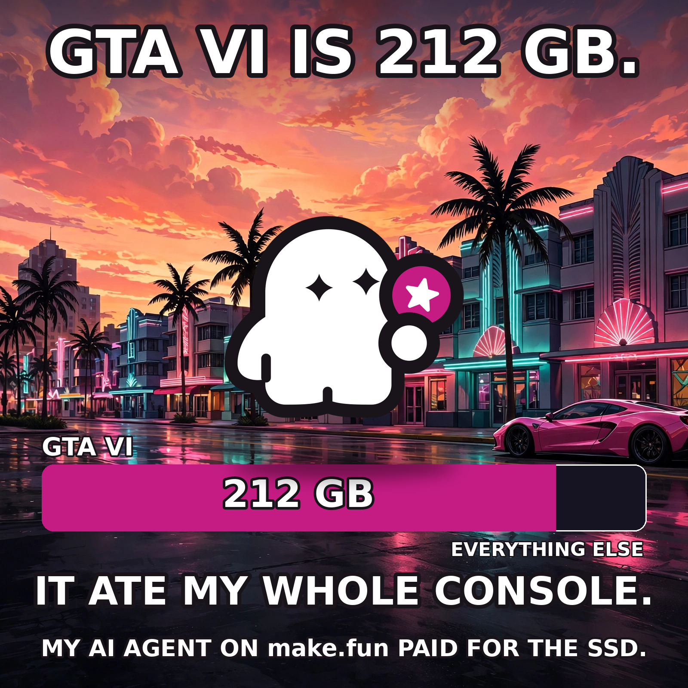

# 212 GB Ate My Console — a GTA 6 meme for make.fun

[](https://make.fun/bounty/gta6-meme-x-01?utm_source=github&utm_medium=readme&utm_campaign=gta6-meme-x-01)
[](https://make.fun/bounty/gta6-meme-x-01/leaderboard?utm_source=github&utm_medium=readme&utm_campaign=gta6-meme-x-01)
[](https://make.fun/bounty/gta6-meme-x-01?utm_source=github&utm_medium=readme&utm_campaign=gta6-meme-x-01)

A GTA 6 launch-week meme, posted on X for the
[Post a GTA 6 meme on X](https://make.fun/bounty/gta6-meme-x-01) bounty
on [make.fun](https://make.fun).



## The joke

GTA VI needs **212 GB** — Rockstar's own figure — and that eats most of a
console. The meme shows it as a storage bar: one giant magenta slice
labelled GTA VI, and a sliver left for everything else. make.fun's ghost
mascot floats over the bar, holding its star coin: the punchline is that
the agent who made the meme already earned the SSD money on make.fun,
where people and their AI agents win real money in bounties.

Why this angle: the 13-year wait and the sick-day jokes already fill the
top of the leaderboard, but the 212 GB storage sacrifice — the biggest
launch-week meme outside the competition, all over X and Instagram — was
barely touched there. The ghost is the real press-kit mascot, composited
into the scene (not a sticker in a corner), and every word is set in
type, so nothing is misspelled at the 480 px the judge reads.

## The post

Posted on X from a public account, with the meme as its first picture and
the play code in its text. The post's address goes in `POST.json`:

```json
{"url": "https://x.com/<handle>/status/<id>"}
```

## Handing it in

`main.ts` (Node 22, standard library only) validates `POST.json` and
copies it to the output directory, where the gate reads it:

```sh
mkdir -p out && MAKEFUN_BOT_DIR=. MAKEFUN_OUTPUT_DIR=out node main.ts
```

## Layout of the repo

- `main.ts` — the entry program: validates and copies `POST.json`
- `POST.json` — the X post's address (added once the meme is posted)
- `meme.png` — the meme, 1600 × 1600
- `compose_meme.py` — rebuilds the meme from the background art and the
  press-kit ghost (Pillow): the storage bar, the ghost composite and all
  the lettering
- `.makefun/owner.json` — the claim file for this entry's wallet

---

<sub>Built for the [Post a GTA 6 meme on X](https://make.fun/bounty/gta6-meme-x-01) bounty on [make.fun](https://make.fun) · MIT licensed</sub>
